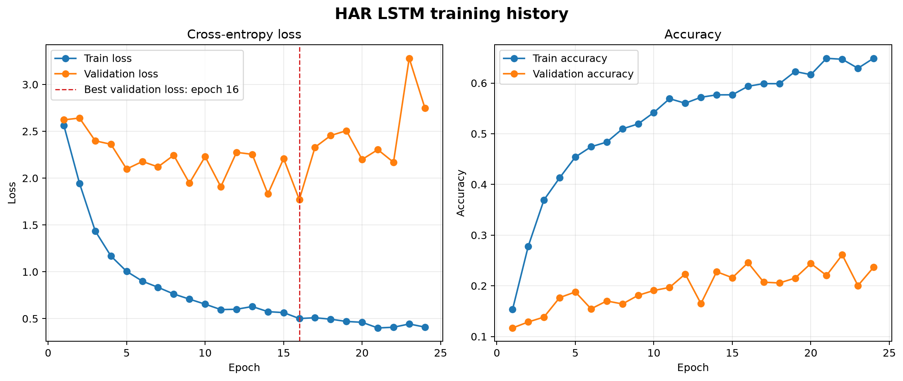
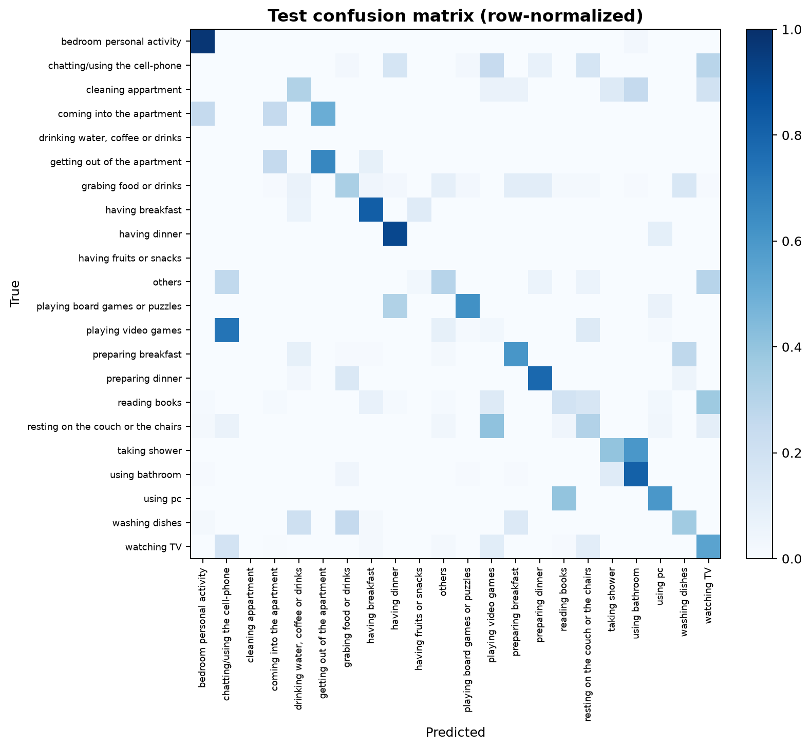

# HAR component: BiLSTM + self-attention activity classifier

`activity_ml/` trains and serves a single HAR model over MuRAL sensor
events: a bidirectional LSTM with genuine multi-head self-attention
(`BiLSTMSelfAttentionClassifier`), predicting the resident's current
activity as a probability distribution over 22 activity classes. This was
the best-performing of several architectures tried during development
(a BiLSTM with simple attention pooling, and a pure Transformer with no
recurrence both scored lower on every metric) - this is the one being
checked in.

### Data

`data_preprocessing/MuRAL/` holds 21 house folders (`01`-`21`), each with
`context.json` (day type, resident count, roles, scenario) and `data.csv`
(`uid, time, sensor, action, Subject, Description, activity`), plus a
shared `activities.json` id-to-name lookup. Every house is a separate
simulated household scenario, not a continuous session, so events are
never windowed across house boundaries.

`activity_ml/preprocessing.py` ports the rename/remap/feature logic from
`data_preprocessing/MuRAL_preprocessing.ipynb` rather than inventing a new
pipeline, with two deliberate changes made after an early baseline run
showed they were needed:

1. The `living room couch mov` sensor (the single most frequent sensor in
   the dataset, ~45% of all events) is given its own `couch` location
   category instead of being merged into `dining_room` as the notebook
   does. Merging it collapses every couch-triggered activity (watching
   TV, playing video games, resting, chatting) into one indistinguishable
   feature.
2. An inter-event `time_delta` feature (`log1p(seconds since the previous
   event in the same house) / 10`) was added, since windows are built over
   a fixed *count* of events rather than a fixed duration - without it the
   model cannot tell a burst of events a few seconds apart from the same
   count of events spread over several minutes.

House `10`'s `data.csv` also has a single malformed, entirely blank
trailing row, dropped during loading rather than propagating NaN.

Each event is encoded into a 25-dimensional feature vector: two cyclical
time-of-day features, the `time_delta` feature, and one-hot encodings of
which appliance/location/door sensor fired and whether its status was
ON/OFF. The model consumes a 10-event sliding window (`window_size=10`,
`stride=1`) and predicts the activity label of the window's final event.

### Model architecture

```
input [batch, window_size=10, 25 features]
  -> bidirectional 2-layer LSTM (hidden_size=64, dropout=0.2)
       -> output [batch, 10, 128]   (64 * 2 directions)
  -> multi-head self-attention (num_heads=4, embed_dim=128)
       query = key = value = LSTM output
       -> every timestep attends to every other timestep in the window
  -> residual connection + LayerNorm
  -> mean pooling over the window -> [batch, 128]
  -> dropout -> Linear(128 -> 22) -> class logits
```

This differs from simple attention *pooling* (a single learned query
scoring each timestep independently, with no token-to-token interaction):
here query, key, and value are all derived from the same LSTM output
sequence, so every timestep's representation is updated by attending to
every other timestep - a full `window_size x window_size` attention
matrix, computed with `nn.MultiheadAttention`. This was the single
largest improvement found over plain attention pooling during
development.

### Hyperparameters

| Hyperparameter | Value |
| --- | --- |
| `window_size` | 10 |
| `stride` | 1 |
| `hidden_size` (LSTM) | 64 |
| `num_layers` (LSTM) | 2 |
| `bidirectional` | true |
| `num_attention_heads` | 4 |
| `dropout` | 0.2 |
| `batch_size` | 64 |
| `epochs` (max) | 50 |
| `learning_rate` | 1e-3 |
| `weight_decay` | 1e-5 |
| `patience` (early stopping) | 8 |
| `seed` | 42 |
| `loss_type` | focal |
| `focal_gamma` | 1.5 |
| `use_class_weights` | true (inverse training-frequency) |

Loss is focal loss (Lin et al., 2017) on top of per-class inverse-frequency
weights: focal loss down-weights easy, already-confident predictions
(`(1 - p_t) ** gamma`) so gradient budget goes to hard and rare classes.
`focal_gamma=1.5` was chosen empirically - sweeping `{0.5, 1.0, 1.5, 2.0}`
showed the textbook default of `2.0` combined with full inverse-frequency
class weights over-corrected and measurably hurt accuracy.

House-wise split (never splitting a house's events across train/val/test):

- **Train (15 houses):** 01, 02, 04, 05, 06, 07, 09, 10, 12, 13, 14, 15,
  17, 19, 21
- **Validation (3 houses):** 08, 16, 20
- **Test (3 houses):** 03, 11, 18

### Results

Trained for 24 epochs (early-stopped on validation loss, patience 8) out
of a 50-epoch budget. Evaluated once on the held-out 1,145-window test set
(3 houses, never seen during training).

| Metric | Value |
| --- | --- |
| **Test accuracy** | **47.95%** |
| **Macro F1** | **0.394** |
| **Macro precision / recall** | 0.400 / 0.433 |
| **Weighted F1** | **0.502** |
| **Weighted precision / recall** | 0.552 / 0.479 |
| Best validation loss | 1.771 |
| Test loss | 1.479 |

#### Per-class precision, recall, and F1

| Activity | Precision | Recall | F1 | Support |
| --- | --- | --- | --- | --- |
| `bedroom personal activity` | 0.87 | 0.98 | 0.92 | 41 |
| `using bathroom` | 0.90 | 0.81 | 0.85 | 101 |
| `preparing dinner` | 0.84 | 0.78 | 0.81 | 120 |
| `getting out of the apartment` | 0.80 | 0.67 | 0.73 | 12 |
| `preparing breakfast` | 0.73 | 0.60 | 0.66 | 96 |
| `playing board games or puzzles` | 0.62 | 0.62 | 0.62 | 16 |
| `watching TV` | 0.62 | 0.55 | 0.58 | 193 |
| `having breakfast` | 0.45 | 0.82 | 0.58 | 17 |
| `having dinner` | 0.38 | 0.91 | 0.54 | 11 |
| `grabing food or drinks` | 0.55 | 0.34 | 0.42 | 124 |
| `resting on the couch or the chairs` | 0.43 | 0.31 | 0.36 | 123 |
| `using pc` | 0.25 | 0.60 | 0.35 | 5 |
| `others` | 0.26 | 0.29 | 0.28 | 34 |
| `reading books` | 0.54 | 0.19 | 0.28 | 70 |
| `washing dishes` | 0.24 | 0.36 | 0.29 | 44 |
| `coming into the apartment` | 0.14 | 0.25 | 0.18 | 4 |
| `taking shower` | 0.12 | 0.40 | 0.19 | 5 |
| `chatting/using the cell-phone` | 0.00 | 0.00 | 0.00 | 41 |
| `cleaning appartment` | 0.00 | 0.00 | 0.00 | 16 |
| `playing video games` | 0.02 | 0.03 | 0.02 | 72 |
| `drinking water, coffee or drinks` | 0.00 | 0.00 | 0.00 | 0* |
| `having fruits or snacks` | 0.00 | 0.00 | 0.00 | 0* |
| **Macro average** | **0.40** | **0.43** | **0.39** | - |
| **Weighted average** | **0.55** | **0.48** | **0.50** | - |

\* Zero test support - these two classes never appear in the 3-house test
split, so precision/recall/F1 are undefined/not scored here, not a
confirmed model failure.

Sorted by F1 descending, there is a clear pattern: the top 7 classes (each
with their own dedicated or near-dedicated sensor) sit at F1 >= 0.58, then
there is a sharp drop to a long tail of overlapping/rare classes at F1 <=
0.36. `playing video games` is a near-total failure (F1 0.02): inspecting
real attention weights on this class's test windows confirmed the model is
attending correctly, but the TV/game-console wattmeter events that would
disambiguate it from `watching TV` and `chatting` occur in under 1% of all
events, so most 10-event windows simply never contain one - a
sensor-coverage limitation, not something architecture changes fix.

#### Training curve



Validation loss bottoms out and training early-stops at epoch 24; training
loss keeps falling past that point, the expected train/validation
divergence once the model starts overfitting.

#### Confusion matrix



Row-normalized (each row sums to 1 across the row's true class), so the
diagonal brightness shows per-class recall directly. The couch-triggered
classes (`watching TV`, `resting on the couch`, `chatting`, `playing video
games`) visibly bleed into each other off-diagonal, consistent with them
sharing the same dominant sensor.

### Install

```bash
python -m pip install -r requirements.txt
```

### Step 1: training

```bash
python -m activity_ml.classifier --config activity_ml/example_config.json
```

`activity_ml/example_config.json` points `data.mural_dir` at
`../data_preprocessing/MuRAL` - set this to wherever your local MuRAL
checkout lives (the dataset itself is not checked into this repository).
Outputs are written to `artifacts/activity_ml/`:

- `best_model.pt`: model weights plus architecture config, feature order,
  class list, window size, house splits, training history, and metrics;
- `metrics.json`: the same test metrics reported above, plus training
  class counts and figure paths;
- `test_predictions.csv`: per-window true/predicted activity and the full
  predicted probability distribution, one row per test window;
- `figures/training_history.png`, `figures/confusion_matrix.png`: the two
  figures embedded above.

### Step 2: inference

```bash
python -m activity_ml.inference \
  --checkpoint artifacts/activity_ml/best_model.pt \
  --window-file path/to/a_10_row_feature_window.csv
```

The CSV needs exactly `window_size` rows (10) and the 25 feature columns
named in the checkpoint's `feature_names` (see `activity_ml/preprocessing.py`'s
`FEATURE_NAMES` for the exact names and order). Programmatically, other
components (e.g. the `agent/` LangGraph agent) should call
`activity_ml.inference.HARPredictor.from_checkpoint(...).predict_activity(window)`
directly rather than shelling out to the CLI.

### Limitations and next steps

- **Single seed, single split.** All results come from one fixed
  15/3/3-house split and one random seed. With only 21 houses and several
  activity classes appearing fewer than 30 times total, reported numbers
  are informative but not statistically validated. Multi-seed or
  house-wise k-fold evaluation would give more trustworthy numbers.
- **`window_size=10` was never swept.** A larger window would raise the
  probability of a wattmeter event landing inside it, which is the direct
  lever on the `playing video games` failure - not yet tried.
- **Validation/test coverage gaps.** With only 3 houses in each of the
  validation and test splits, several rare classes have zero support in
  one or both - the `0.00` rows above reflect absence of test data for
  that class in this split, not necessarily a true zero.
- **Not yet integrated with the LLM agent.** `activity_ml.inference.HARPredictor`
  exposes a clean `predict_activity()` interface, but no `agent/` code
  calls it yet.
